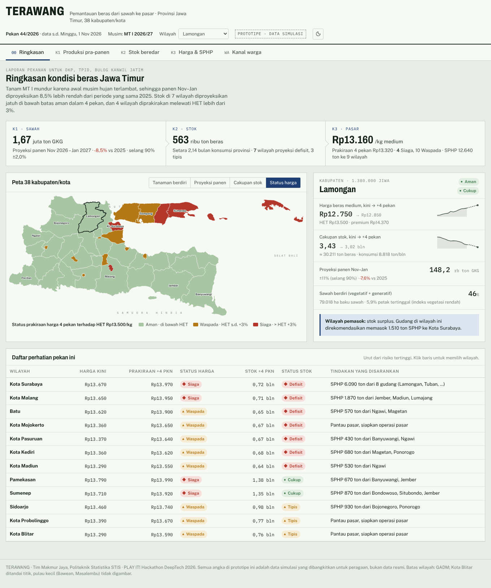

# TERAWANG — Dasbor Prototipe

**Pemantauan Beras dari Sawah ke Pasar** untuk estimasi produksi, stok beredar, dan peringatan dini harga berbasis citra satelit dan AI. Wilayah prototipe: **Jawa Timur, 38 kabupaten/kota**. Semua angka masih **data simulasi**.



## Halaman

| Rute | Halaman | Isi |
|---|---|---|
| `/` | Ringkasan | Rantai K1 → K2 → K3, peta 4 lapisan, kartu wilayah terpilih, daftar perhatian |
| `/produksi` | K1 Produksi pra-panen | Kalender panen, profil radar Sentinel-1 VH, proyeksi panen, fase tumbuh |
| `/stok` | K2 Stok beredar | Taksiran stok (filter Kalman), neraca bulanan, cakupan stok semua wilayah |
| `/harga` | K3 Harga & SPHP | Prakiraan harga 4 pekan, peta rute SPHP, tabel rekomendasi penyaluran |
| `/whatsapp` | Kanal warga | Contoh percakapan bot WhatsApp dan siaran peringatan |

## Teknologi

Vite, React 19, TypeScript, Tailwind CSS v4, React Router. Peta dan grafik digambar langsung dengan SVG tanpa pustaka grafik.

## Struktur

```
src/
  App.tsx                  # rute halaman
  main.tsx
  index.css                # token warna (terang/gelap) dan gaya komponen
  components/
    layout/                # AppShell (kop, tab, footer), ThemeToggle, nav
    charts/                # PetaJatim, LineChart, Sparkline
    ui/                    # Panel, KpiStrip, DataTable, Pill status
  lib/
    data.ts                # simulasi data 38 wilayah, status, lapisan peta, rute SPHP
    format.ts              # format angka/tanggal, skala, RNG deterministik
    jatim.json             # batas kab/kota Jawa Timur (path SVG, disederhanakan dari GADM)
    selection.tsx          # wilayah terpilih (dibagi antarhalaman)
    theme.tsx, tooltip.tsx, utils.ts
  pages/                   # Ringkasan, Produksi, Stok, Harga, Whatsapp
deploy/
  deploy-vps.sh            # build + jalankan server di VPS
  serve.py                 # server statis dengan fallback SPA
scripts/
  geo.py                   # pembuat jatim.json dari GADM level 2
```

## Menjalankan

```bash
npm install
npm run dev       # http://localhost:5173
npm run build     # hasil di dist/
npm run lint
```

## Deploy ke VPS

Dasbor disajikan sebagai file statis hasil build, tanpa sudo:

```bash
git clone git@github.com:afrzl/terawang.git
cd terawang
bash deploy/deploy-vps.sh        # PORT=8080 bisa diganti
```

Skrip ini menjalankan `git pull`, `npm ci`, `npm run build`, lalu menyajikan `dist/` lewat `deploy/serve.py` (server Python dengan fallback SPA, jadi `/stok` atau `/harga` bisa dibuka langsung). Server didaftarkan di crontab `@reboot`. Untuk memperbarui, jalankan ulang skrip yang sama.

Demo: http://148.230.96.97:8080

## Memperbarui batas wilayah

```bash
python3 scripts/geo.py gadm41_IDN_2.json src/lib/jatim.json
```

Catatan peta: Kota Blitar tidak memiliki poligon di GADM sehingga ditandai titik; Pulau Bawean dan Masalembu tidak digambar.

## Tim

Tim Makmur Jaya, Politeknik Statistika STIS: Farid Ridho, Danang Wisnu Prabowo, Muh. Nur Afrizal.
