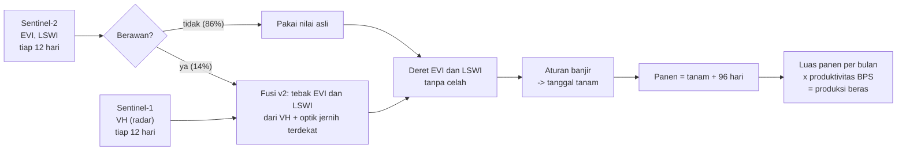
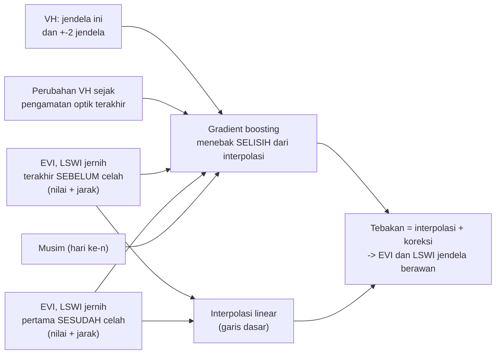
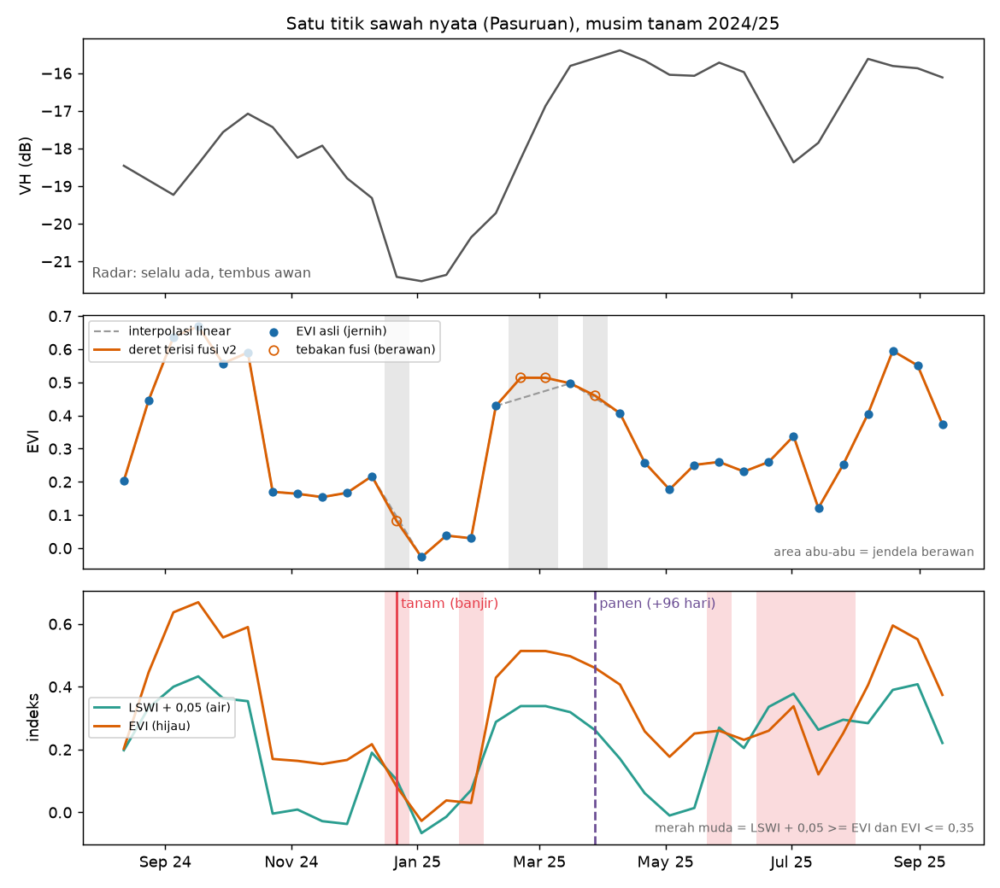
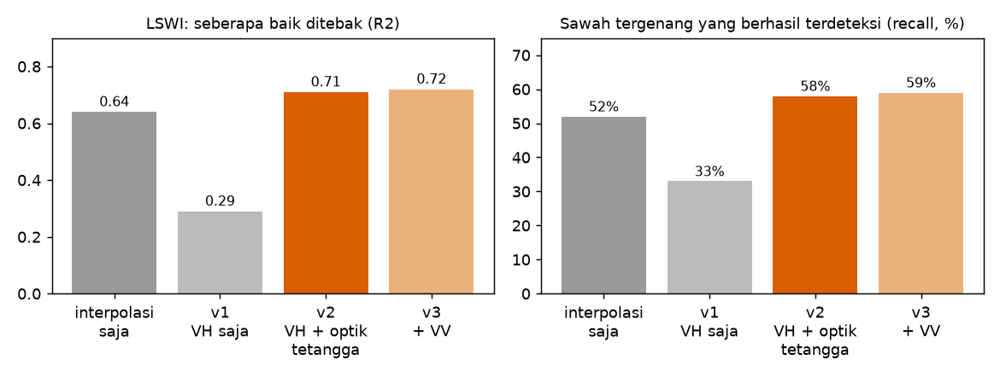
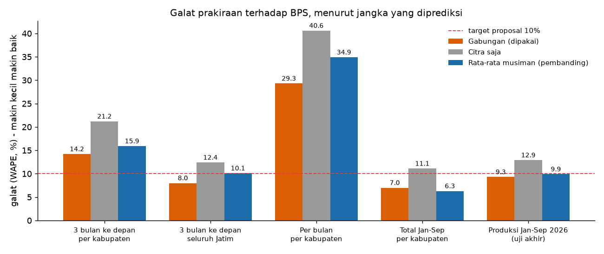
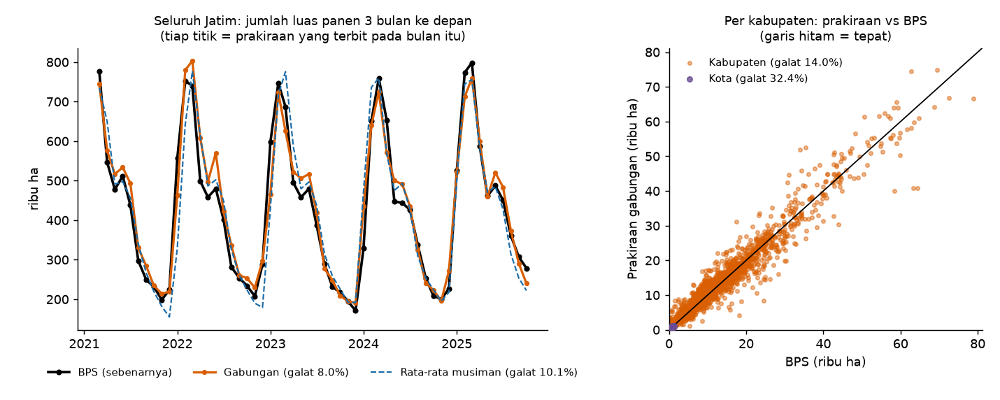

# Aturan banjir + fusi Sentinel-1 (indikator awal tanam K1)

Tujuan: menaksir **kapan sawah ditanam** (genangan) dan **kapan dipanen** (+96 hari), per kabupaten, tanpa data lapangan.
Rujukan aturan: Xiao 2006, Dong 2016 (aturan banjir optik). Label di aplikasi: MODEL.

**Ringkasan:** citra (aturan banjir + fusi) dikalibrasi ke BPS 7 tahun per kabupaten, lalu digabung dengan riwayat BPS (**model gabungan**). Tanpa data BPS tahun berjalan, prakiraan total produksi Jan-Sep per kabupaten 4 minggu sebelumnya: **WAPE 9,3%**. Per bulan per kabupaten masih ±29%.

## Alur



## Variabel dan indikator

Urut dari yang paling menentukan hasil.

| # | Variabel | Arti | Sumber | Peran |
|---|---|---|---|---|
| 1 | **EVI** | Kehijauan tanaman (rendah = belum tanam) | Sentinel-2: 2,5 (B8-B4) / (B8 + 6 B4 - 7,5 B2 + 1) | Dipakai dua kali: penanda banjir dan verifikasi padi |
| 2 | **LSWI** | Kandungan air (tinggi = tergenang) | Sentinel-2: (B8-B11) / (B8+B11) | Sinyal genangan = tanda tanam |
| 3 | Titik sawah | 400 titik acak per kab/kota di sawah (ESA WorldCover, Cropland) | GEE | Unit analisis; luas sawah kab jadi pengali luas panen |
| 4 | Jendela | Komposit median 12 hari, mulai Agu 2018 | - | Sumbu waktu; jeda tanam-panen = 8 jendela |
| 5 | **VH** (dB) | Pantulan radar; rendah saat tergenang, naik saat padi tumbuh. Tembus awan | Sentinel-1 | Hanya mengisi jendela berawan (14%) |
| 6 | Jernih | Cloud Score+ >= 0,6 | Sentinel-2 | Memisahkan jendela asli dan jendela yang diisi |

## Aturan banjir (per titik, per jendela)

1. **Tergenang:** `LSWI + 0,05 >= EVI` dan `EVI <= 0,35` (air banyak, belum hijau).
2. **Dipastikan padi:** EVI naik sampai `>= 0,5` dalam 36-72 hari sesudahnya (membuang rawa dan tambak).
3. **Panen:** tanggal genangan + 96 hari (8 jendela; dipilih dari data latih 2025).

```
hari:   0 ---------- 36..72 ------------------ 96
        genangan     EVI naik (verifikasi)      panen
        LSWI tinggi  hijau >= 0,5
        EVI rendah
```

## Fusi v2 (mengisi jendela berawan)

**Masalah:** di ±14% jendela, optik tertutup awan, padahal genangan hanya berlangsung 2-3 minggu dan mudah terlewat.
**Ide:** EVI dan LSWI berubah pelan, jadi nilai jernih sebelum dan sesudah celah adalah petunjuk terbaik. Radar (VH) menambah petunjuk perubahan selama celah.



- **Menebak selisih, bukan nilai penuh:** interpolasi sudah akurat untuk perubahan lambat; model hanya mengoreksi bila VH menunjukkan perubahan.
- **Dilatih** hanya pada jendela jernih sampai 2025, dengan celah buatan (±30% blok pendek disembunyikan) agar terbiasa tanpa tetangga dekat.
- **Hanya jendela berawan yang diisi.** Pengamatan jernih tidak diubah.



*Titik di Pasuruan: jendela 22 Des 2024 berawan (kotak abu-abu). Fusi mengisi EVI rendah dan LSWI tinggi, sehingga banjir terdeteksi (garis merah) dan panen ditaksir akhir Maret (garis ungu). Hanya banjir yang disusul EVI naik >= 0,5 dalam 36-72 hari yang dihitung; blok merah muda lain tidak lolos verifikasi.*



*Uji 2026, 30% pengamatan jernih disembunyikan lalu ditebak. Interpolasi saja sudah kuat; VH saja (v1) lebih buruk dari interpolasi; v2 terbaik; tambahan VV (v3) tidak menambah.*

## Dari tanggal ke produksi

```
luas panen bulan m = porsi titik panen di bulan m  x  luas sawah kab  x  koefisien kab
produksi beras     = luas panen  x  produktivitas beras/ha kab (BPS tahun lalu)
```

- **Koefisien per kabupaten** dihitung dari BPS bulanan 2019 sampai tahun lalu (7 tahun), ditarik ke koefisien global agar tidak ekstrem.
- Genangan yang **belum selesai diverifikasi** tetap dihitung dengan bobot peluang: 38% (belum ada jendela verifikasi), 30%, 22%, 13% (makin lama EVI tidak naik, makin kecil). Peluang dipelajari dari riwayat citra, bukan dari BPS.

## Model gabungan (yang dipakai)

`luas panen = w1 x Citra + w2 x Rata-rata musiman + w3 x Tahun lalu`

| Komponen | Isi |
|---|---|
| **Citra** | Taksiran aturan banjir + fusi v2 x koefisien kabupaten |
| **Rata-rata musiman** | Rata-rata luas panen bulan yang sama di tahun-tahun lalu (BPS) |
| **Tahun lalu** | Luas panen bulan yang sama di tahun final terakhir (BPS) |

**Bobot** dicari dengan *non-negative least squares* dari prediksi leave-one-year-out di tahun latih (tiap tahun dinilai tanpa melihat dirinya sendiri). Hasilnya kira-kira citra 0,4-0,55, rata-rata musiman 0,3-0,55, tahun lalu 0-0,3.
**Tidak memakai data BPS tahun berjalan**, hanya riwayat. Jadi bisa dipakai sebelum BPS menerbitkan angka bulan itu.

## Data latih dan data uji

### Data latih

| Data | Sumber | Periode | Dipakai untuk |
|---|---|---|---|
| **Sentinel-2** (pita B2, B4, B8, B11 -> EVI, LSWI; masker awan Cloud Score+) | Google Earth Engine: `COPERNICUS/S2_SR_HARMONIZED` | Agu 2018 - 2025 | Melatih fusi; aturan banjir; peluang verifikasi |
| **Sentinel-1** (polarisasi VH, mode IW) | Google Earth Engine: `COPERNICUS/S1_GRD` | Agu 2018 - 2025 | Fitur fusi (mengisi celah awan) |
| **Peta sawah** (kelas Cropland) | ESA WorldCover v200 (peta 2021) | - | Memilih 400 titik per kab/kota; luas sawah kab |
| **BPS: luas panen padi bulanan per kab/kota** | BPS Prov. Jatim, tabel dinamis [Luas Panen Padi menurut Kabupaten/Kota](https://jatim.bps.go.id/en/statistics-table/2/NTc4IzI=/luas-panen-padi-menurut-kabupaten-kota.html) (Survei KSA) | **2019 sampai tahun sebelum tahun uji** (paling jauh 2019-2025) | Koefisien tiap kabupaten, rata-rata musiman, tahun lalu, bobot gabungan |
| **BPS: produktivitas beras/ha per kab** (produksi beras / luas panen) | BPS Prov. Jatim, BRS No. 71/11/35/Th. XXIV (2 Nov 2026), tabel Jan-Sep 2025 (angka tetap) | 2025 | Mengubah luas panen menjadi produksi |

Fusi dan peluang verifikasi dilatih **tanpa label BPS**. Hanya koefisien kabupaten dan bobot gabungan yang memakai BPS.

### Data uji

| Uji | Data | Sumber |
|---|---|---|
| **Uji bergulir 2022-2025** | Luas panen bulanan per kab/kota pada tahun uji; model dilatih hanya dengan tahun-tahun sebelumnya | Tabel BPS yang sama di atas |
| **Uji akhir 2026** | Luas panen dan produksi beras per kab/kota **Jan-Sep 2026** (Jan-Agu angka tetap, Sep sementara) | BPS Prov. Jatim, BRS No. 71/11/35/Th. XXIV (2 Nov 2026), *Luas Panen dan Produksi Padi di Provinsi Jawa Timur 2026 (Angka Sementara, Hasil KSA Amatan September 2026)*; model dilatih 2019-2025 |
| **Uji fusi** | 30% pengamatan Sentinel-2 jernih tahun 2026 yang sengaja disembunyikan | Sentinel-2 2026 |

Pada uji, citra 2026 hanya dipakai sebagai **masukan** (sampai tanggal potong), bukan label. Data BPS tahun uji tidak pernah dipakai untuk melatih.

## Bukti akurasi (model gabungan)

Angka = **galat** rata-rata terhadap BPS (WAPE); **makin kecil makin baik**. Prakiraan dibuat dengan batas informasi nyata (hanya citra dan data BPS yang sudah tersedia saat itu).

| Yang diprediksi | **Gabungan** | Citra saja | Rata-rata musiman (pembanding) |
|---|---|---|---|
| **3 bulan ke depan, per kabupaten** (angka utama) | **14,2%** | 21,2% | 15,9% |
| 3 bulan ke depan, seluruh Jatim | **8,0%** | 12,4% | 10,1% |
| Per bulan, per kabupaten | **29,3%** | 40,6% | 34,9% |
| Total Jan-Sep, per kabupaten | **7,0%** | 11,1% | 6,3% |
| Produksi Jan-Sep 2026, per kabupaten (uji akhir) | **9,3%** | 12,9% | 9,9% |

- **3 bulan ke depan:** terbit tiap awal bulan, 56 penerbitan 2021-2025. Untuk jendela Nov-Jan (terbit Okt-Des): gabungan 17,2% (kabupaten 14,0%, kota 32,4%), rata-rata musiman 22,7%.
- **Baris lain:** prakiraan 4 minggu sebelum bulan target, rata-rata 2022-2025; baris terakhir adalah uji akhir 2026.
- Pengisian celah awan oleh fusi (uji 2026): LSWI R2 0,71, recall banjir 58%.



*Batang oranye (gabungan) hampir selalu paling pendek. Garis merah = target proposal 10%.*



*Kiri: seluruh Jatim, prakiraan gabungan (oranye) mengikuti BPS (hitam) di tiap musim. Kanan: tiap titik = satu kabupaten pada satu penerbitan; makin dekat garis hitam makin tepat. Kota (ungu) kecil dan menumpuk dekat nol.*

## Batas yang harus disebut

- **Per bulan per kabupaten masih ±29%.** Target <= 10% hanya tercapai untuk **total Jan-Sep per kabupaten**.
- Manfaat citra di atas rata-rata musiman **kecil**: ±16% lebih baik di pola bulanan, tetapi untuk total tidak lebih baik.
- **Kota lemah** (28-32%); sawah kecil.
- Luas sawah memakai proksi WorldCover, bukan lahan baku sawah resmi.
- Tanam baru **terkonfirmasi** 24-60 hari sebelum panen, jadi prakiraan dini efektif ±1-2 bulan.
- Asumsi: BPS tahun lalu final rilis 1 Maret. Fusi dilatih pada data optik sampai 2025 (tanpa label BPS). Awal deret 2018 cakupan optik 30%, jadi Jan-Mar 2019 tidak dipakai.
- Baseline BPS 4,5% hanya bisa dicapai bila angka final tahun lalu sudah terbit.

## Peningkatan ke depan (urut prioritas)

| # | Peningkatan | Alasan | Butuh |
|---|---|---|---|
| 1 | Label lapangan (KSA, ubinan) | Deteksi fase dan luas panen bisa dilatih dan diuji langsung | Data dari BPS Jatim |
| 2 | Peta sawah resmi (lahan baku sawah) | Proksi WorldCover jadi pengali tiap kabupaten; kota paling terdampak | Data LBS |
| 3 | Jeda tanam-panen per wilayah dan varietas | Sekarang tetap 96 hari | Tanggal fase (KSA) |
| 4 | Cuaca dan Fay-Herriot | Tahun menyimpang (misalnya April 2026) sulit ditebak | Curah hujan, ubinan |
| 5 | Ketidakpastian dan bobot relatif | Bobot sekarang didominasi kabupaten besar; belum ada selang kepercayaan | Bootstrap |
| 6 | Ketahanan operasional | Pergantian satelit (VH bergeser -1 dB), tambah Landsat/HLS | Pipeline Airflow |

Skrip: `scripts/gee/*_titik.py` dan `riwayat_titik.py` (ambil citra), `scripts/k1/fusi_v2_s1_s2.py` (fusi), `multitahun.py` (kalibrasi), `nowcast_est2.py` dan `nowcast_eval.py` (uji nowcast), `scripts/bps/parse_luas_panen_bulanan.py` (data BPS), `gambar_fusi.py` (gambar).
